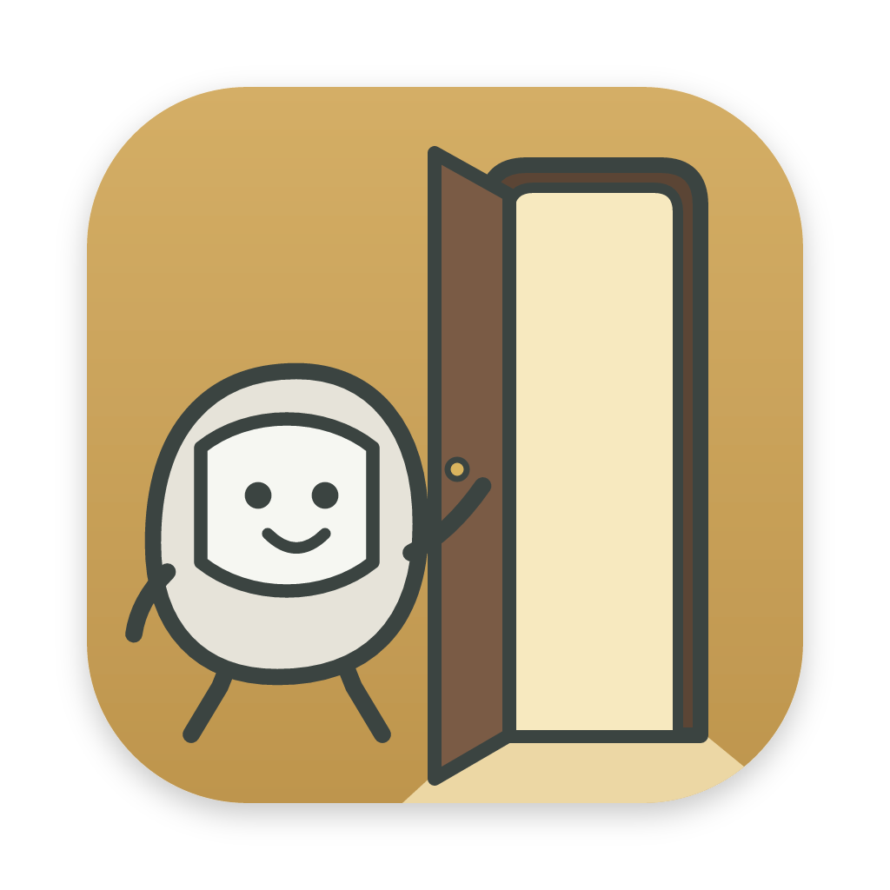
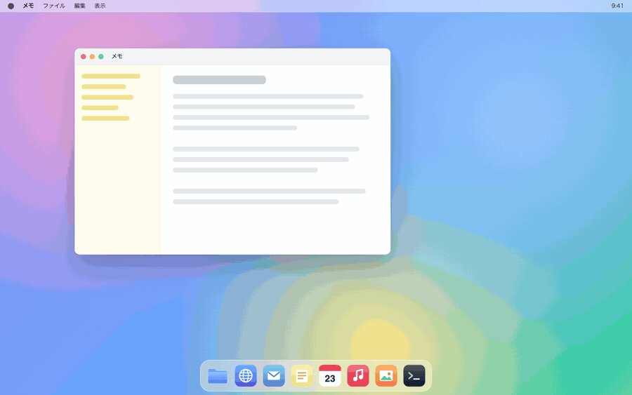

# OpenSesame!

[English](README.md) | 日本語



OpenSesame! は、キーを押している間だけ表示される macOS 用のランチャーです。

起動キー（初期設定では左 Control + 左 Option）を押している間、キーボード型のパネルが表示されます。そのまま割り当てたキーを押すと、アプリケーションやフォルダ、Webサイトを開いたり、コマンドを実行したり、前面のウィンドウを画面の左半分・右半分などに配置したり、画面の解像度や壁紙を変えたりできます。

小さな Mac 向けアプリのシリーズ [kobito-tools](https://github.com/kobito-tools) の1つです。



## できること

| 種類 | キーを押すと |
|---|---|
| ウィンドウ整形 | 前面のウィンドウを動かして大きさを変えます（半分・4分の1・3分の1・3分の2・端の調整・隣の画面へ移すなど。[ウィンドウ整形の種類](#ウィンドウ整形の種類)を参照） |
| アプリ | アプリケーションを起動するか、前面に出します。前面にあるときは隠すこともできます |
| フォルダ | フォルダを Finder で開きます |
| Webサイト | URL を既定のブラウザで開きます |
| コマンド | ターミナルで打つコマンドを1行で動かします（例：`uv run app.py`） |
| 解像度 | 画面を選んだ解像度にします。2つ以上選ぶと押すたびに順に切り替え、「1段階上げる・下げる」なら今の解像度から隣へ変えます（[画面の解像度を変える](#画面の解像度を変える)を参照） |
| 壁紙 | アプリに入っている壁紙か自分の画像を、すべての画面か特定の画面の壁紙にします（[壁紙を変える](#壁紙を変える)を参照） |

1つのキーに、表盤面と裏盤面（Shift）で1つずつ、あわせて2つの項目を割り当てられます。

## 動作環境

- macOS 11 以降（Apple Silicon / Intel）
- 入れるときに Mac の中でアプリを作るため、初めては数分かかります。

## インストール

OpenSesame! は、ソースコードを取ってきて、ターミナルで `setup.sh` を実行して入れます。`setup.sh` は、必要な道具を確かめ、Mac の中で `OpenSesame!.app` を作り、アプリケーションフォルダに置きます。手元で作ったアプリなので、初回起動時に「開発元を確認できません」という警告は出ません。

### 1. ソースコードを取ってくる

どちらの方法でもかまいません。フォルダは、ホームフォルダなど、残しておける場所に置いてください。更新するときにも使います。

| 方法 | やり方 |
|---|---|
| Git | ターミナルで `git clone https://github.com/kobito-tools/OpenSesame.git` を実行します。`OpenSesame` フォルダができます |
| ZIP | GitHub のこのページで「Code」→「Download ZIP」をクリックし、ダウンロードした ZIP をダブルクリックして展開します。`OpenSesame-main` フォルダができます |

### 2. setup.sh を実行する

ターミナルでそのフォルダへ移り、`setup.sh` を実行します。

```bash
cd OpenSesame
./setup.sh
```

ZIP の場合は `cd OpenSesame-main` です（`cd ` と打ってから、フォルダをターミナルのウィンドウへドラッグして Return を押しても移れます）。

途中でいくつか質問されます。Return だけを押すと、大文字で示された答えを選びます。

| オプション | すること |
|---|---|
| `./setup.sh --help` | オプションと手順を表示します |
| `./setup.sh --dry-run` | 何も変えずに、何をするかだけを表示します |
| `./setup.sh --yes` | すべての質問に既定の答えを選びます（このときアプリはアプリケーションフォルダへ移しません） |

何度実行しても大丈夫です。

### 3. setup.sh がすること

| 手順 | 内容 |
|---|---|
| 道具の確認 | Xcode Command Line Tools と Node.js 20 以降があるかを確かめます。無いときは入れ方（`xcode-select --install`、Node.js は [nodejs.org](https://nodejs.org/) か `brew install node`）を表示して止まります。入れてから、もう一度 `./setup.sh` を実行してください |
| Rust | Rust が無いときは、公式の手順（[rustup](https://rustup.rs/)）で入れるかを尋ねます |
| ビルド | ソースのフォルダの中に `OpenSesame!.app` を作ります。数分かかります |
| アプリケーションフォルダへ移す | アプリケーションフォルダの `kobito-tools` フォルダ（`/Applications/kobito-tools/`）へ移すかを尋ねます。**y** と答えてください。フォルダが無ければ作り、シリーズのアイコンを付けます。すでに OpenSesame! がある場合は、置き換えてよいかを尋ねます |
| 起動情報 | シリーズのほかのアプリが OpenSesame! を起動するための小さなファイルを書き出します |
| フォルダの場所を記す | ソースのフォルダの場所を、`~/Library/Application Support/kobito-tools/repos/opensesame` にリンクとして記します |
| 許可の案内 | アクセシビリティの許可のしかたと、起動するコマンドを表示します |

移すかの質問に **n** と答えた場合、`OpenSesame!.app` はソースのフォルダに残ります。そのままでも使えますが、アプリケーションフォルダに置いたほうが、macOS が許可を保ちやすくなります。あとから自分で移してもかまいません。

`/Applications` の直下に以前の `OpenSesame!.app` が残っていても、消しません。使わなければ、ゴミ箱へ移してください。

### 4. OpenSesame! を起動する

アプリケーションフォルダの `kobito-tools` フォルダを開き、OpenSesame! をダブルクリックします。`setup.sh` の最後に表示される `open` のコマンドでも起動できます。

> **注意:** アプリケーションフォルダから起動してください。ほかの場所から起動すると、下の手順で設定する許可が保持されない場合があります。

### アクセシビリティの許可

OpenSesame! は、他のアプリケーションを操作している間もキー入力を検知するため、macOS のアクセシビリティの許可を必要とします。初回起動時に設定画面に案内が表示されるので、次の手順で許可してください。

1. 案内の「アクセシビリティ設定を開く」をクリックします。
2. 一覧の下にある「＋」をクリックし、アプリケーションフォルダの `kobito-tools` フォルダから OpenSesame! を追加します。
3. OpenSesame! のスイッチをオンにします。

許可が有効になると、数秒で案内が消えてキー入力の監視が始まります。アプリの再起動は不要です。

## 更新

更新しても、設定と登録した項目はそのまま残ります。

1. OpenSesame! を終了します（メニューバーのアイコン →「OpenSesame! を終了」）。動いているアプリは、`setup.sh` が置き換えません。
2. 新しいソースコードを取ってきます。
   - Git の場合：ソースのフォルダで `git pull` を実行します。
   - ZIP の場合：古い `OpenSesame-main` フォルダをゴミ箱へ移してから、もう一度 ZIP をダウンロードして展開します。
3. もう一度 `./setup.sh` を実行し、移すか・置き換えるかの質問に **y** と答えます。
4. 「システム設定」→「プライバシーとセキュリティ」→「アクセシビリティ」の一覧から OpenSesame! を「－」で削除し、追加し直します（作るたびに署名が変わるため、以前の許可が効かなくなります）。

## 使い方

### 基本操作

| 操作 | 動作 |
|---|---|
| 起動キーを押し続ける | パネルを表示します |
| 起動キー + 割り当てたキー | アプリケーション・フォルダ・Webサイトを開く、コマンドを実行する、ウィンドウを配置する、または解像度や壁紙を変えます |
| 起動キー + Shift | 裏盤面に切り替えます。Shift を離すと表盤面に戻ります |
| 起動キー + Shift + 割り当てたキー | 裏盤面に割り当てた項目を実行します |
| 起動キー + `.`（ピリオド） | 設定画面を開きます |
| 起動キーを離す | パネルを閉じます |

設定画面を閉じても、OpenSesame! はバックグラウンドで動作し続けます。

### キーを割り当てる

1. 設定画面上部のキーボード図で、割り当てていないキーをクリックします。
2. 「ウィンドウサイズ変更」「アプリの起動」「フォルダの選択」「Webサイトを開く」「コマンドを実行」「画面の解像度を変える」「壁紙を変える」のいずれかを選択します。
3. アプリケーションまたはフォルダを選択した場合は、表示されたダイアログで対象を指定します。Webサイトを選択した場合は、URL（`https://` は省略可）と表示名を入力します。コマンドを選択した場合は、下の「[コマンドを登録する](#コマンドを登録する)」を見てください。

設定画面右上の「＋ アプリ」「＋ フォルダ」「＋ Webサイト」「＋ コマンド」「＋ 解像度」「＋ 壁紙」から登録することもできます。この場合、空いているキーが自動的に割り当てられます。

登録した項目は、設定画面下部の一覧で表示名や割り当てキーを変更できます。キーボード図の割り当て済みのキーを別のキーへドラッグして移すこともできます。「アイコン」をクリックすると、任意の PNG 画像をアイコンとして設定できます。

アプリの「前面なら隠す」をオンにすると、そのアプリが前面にあるときにもう一度キーを押すとアプリを隠します。押すたびに表示と非表示を切り替えられます。

### ウィンドウ整形の種類

ウィンドウ整形は前面のウィンドウに働き、そのウィンドウがいちばん多く重なっている画面の中で配置します。メニューバーと Dock には重ねません。

| 分類 | 整形 |
|---|---|
| 半分 | 左・右・上・下の半分 |
| 4分の1 | 左上・右上・左下・右下の4分の1 |
| 3分の1 | 左・中央・右の3分の1、上・中段・下の3分の1 |
| 3分の2 | 左・中央・右の3分の2、上・中段・下の3分の2 |
| 端の調整 | 左端・右端・上端・下端を広げる／縮める。押すたびに、その辺だけを画面の12分の1ずつ動かすので、繰り返し押して少しずつ調整できます。画面の端と最小の大きさで止まります |
| 移動・その他 | 中央へ（大きさはそのまま）、ほぼ全画面（周りに少し余白）、全画面、隣の画面へ移す、整形前に戻す |

- 「隣の画面へ移す」は、画面を左から順に見て次の画面へ移します（最後の画面の次は最初の画面）。画面の中での位置と大きさの比率は保ちます。
- 「整形前に戻す」は、OpenSesame! で最初に整形する前の位置と大きさに戻します。続けて何回か整形しても、最初の状態に戻ります。整形した後に手でウィンドウを動かした場合は戻しません。

キーに「ウィンドウサイズ変更」を選ぶと、整形がこの分類ごとに図付きで並びます。検索欄に入力すると、分類をまたいで絞り込めます。設定画面下部の一覧の「キーを割り当てていない整形」にも同じ分類で並び、そこから各整形にキーを選べます。

### コマンドを登録する

ターミナルで打つコマンドを、そのままキーに割り当てられます。たとえば Python で作ったアプリを `uv run app.py` で起動する、といった使い方ができます。

| 欄 | 入れるもの |
|---|---|
| コマンド（1行） | ターミナルで打つのと同じコマンド。改行は入れられません。`&&` でつなげば、いくつかのコマンドを順に動かせます |
| 作業フォルダ（任意） | コマンドを動かすフォルダ。「選ぶ…」で選べます。空のときはホームフォルダで動きます |
| 表示名 | パネルと一覧に出る名前。空のときはコマンドの最初の語になります |

- コマンドは、ログインシェル（`/bin/zsh -l`）を通して動かします。`~/.zprofile` で通した PATH が読まれるので、ターミナルで使える `uv` などのコマンドがそのまま見つかります。`~/.zshrc` だけで PATH を通している場合は見つからないことがあるので、`~/.zprofile` にも書くか、コマンドをフルパス（例: `~/.local/bin/uv run app.py`）で書いてください。
- コマンドは終わるのを待たずに動かします。起動できなかったときや、動かしてすぐ（3秒以内）にエラーで終わったときは、設定画面が開いて、下の知らせ欄に終了コードとエラーの最後の行が出ます。
- コマンドの出力（画面に出る文字）は表示しません。
- 登録したコマンドは、一覧の「編集」で書き換えられます。アイコンは「アイコン」から PNG 画像を選べます（選ばないときは ▶️ を出します）。

> **注意:** 登録したコマンドは、キーを押すたびにそのまま実行されます。中身の分かっているコマンドだけを登録してください。

### 画面の解像度を変える

キーに「画面の解像度を変える」を選び、上のタブで画面を、並んだ図から解像度を選びます。

- 解像度は見た目の大きさ（Retina などの HiDPI の画面では「見た目の解像度」）で、大きさごとに1つずつ、画面と同じ縦横比のものを並べます。「現在」は使用中の解像度、「既定」はその画面の既定の解像度です。「詳しく」をオンにすると、リフレッシュレートの違いや、HiDPI でないモード、縦横比の違うモードも分けて出します。
- 2つ以上選ぶと（8つまで）、キーを押すたびに選んだ順に切り替わり、最後の次は最初に戻ります。文字を大きくする解像度と作業領域を広くする解像度を、1つのキーで行き来するといった使い方ができます。
- 先頭の「1段階上げる」「1段階下げる」を選ぶと、キーを押すたびに、そのときの解像度から1段階大きく・小さくします。段階は上の一覧の並びで、「上げる」は大きい解像度（文字は小さく、作業領域は広く）の方です。いちばん大きい・小さい解像度のときは何も変えず、設定画面で知らせます。2つのキーにそれぞれ登録すると、自由に上げ下げできます。
- 画面はメーカー・型番・製造番号と名前で覚えるので、抜き差ししたり別の端子につなぎ直したりしても同じ画面を指します。
- 画面がつながっていないときや、その解像度に対応していないときは何も変えず、設定画面を開いて知らせます。
- 変えた解像度は、システム設定で変えたときと同じく、ログアウトしても保たれます。一覧の「編集」で選び直せます。

### 壁紙を変える

キーに「壁紙を変える」を選びます。

| 欄 | 入れるもの |
|---|---|
| アプリの壁紙 | アプリに入っている水彩の壁紙3枚（「昼の丘」「夕暮れの展望台」「夜の街」）。押すとその壁紙を使います |
| 画像ファイル | 自分の画像を使うときは、そのパス。手で入力するか、「選ぶ…」で選びます。PNG・JPEG・HEIC などの画像が使えます |
| 対象の画面 | 「すべての画面」か、特定の画面 |
| 表示の仕方 | 「画面いっぱい」「画面に合わせる」「引き伸ばす」「中央に配置」 |
| 余白の色 | 「余白の色を決める」をオンにすると、「画面に合わせる」「中央に配置」で画像のまわりにできる余白の色を選べます。オフのときは macOS に任せます |
| 表示名 | パネルと一覧に出る名前。空のときは画像のファイル名（アプリの壁紙ならその名前）になります |

- macOS は、それぞれの画面でいま表示している Space（デスクトップ）の壁紙だけを変えます。ほかの Space も変えたいときは、その Space に移ってもう一度キーを押してください。
- アプリの壁紙は 3840 × 2160 です。使うときにアプリのデータフォルダへ写してから設定するので、アプリを移したり作り直したりしても壁紙は消えません。
- 画像が移動・削除されているときや、選んだ画面がつながっていないときは何も変えず、設定画面を開いて知らせます。
- 一覧の「編集」で、画像・対象の画面・表示の仕方を変えられます。

### 裏盤面（Shift）を使う

設定画面のキーボード図は、上に表盤面、下に裏盤面（Shift）を並べて表示します。裏盤面のキーを押すと、表盤面とは別の割り当てを登録できます。同じキーでも、表盤面と裏盤面で別々の項目を割り当てられます。登録済みのキーは、ドラッグで別のキーへ移せます。もう一方の盤面のキーへ落とせば、盤面をまたいで移せます（落とした先に割り当てがあれば入れ替えます）。キーボード図の右上の切り替えでは、下の一覧に出す盤面を選びます。裏盤面の項目は、起動キーに加えて Shift を押しながらキーを押すと実行されます。

起動キーに Shift を含めている場合、そちらの Shift は裏盤面の切り替えに使われません（左 Shift を起動キーにしている場合は、右 Shift で切り替えます）。

### 起動キーを変更する

1. 設定画面の「起動キー」欄にマウスポインタを合わせ、delete キーを押します。
2. 使用したい修飾キーを同時に押し、離します。

Control、Option、Command、Shift のうち最大 3 つまで組み合わせることができ、左右のキーは区別されます。Shift だけを起動キーにすることはできません。変更を取り消すには、手順 2 の前に Esc キーを押します。

### 表示を切り替える

設定画面右上で、表示言語（日本語 / English）とキーボード配列（JIS 配列 / 英字配列）を切り替えられます。メニューバーの項目は、次に OpenSesame! を起動したときに、選んだ言語になります。

### ログイン時に自動で起動する

設定画面右上の「ログイン時に起動」を「オン」にします。ログインすると、設定画面は開かずにメニューバーに常駐した状態で起動します。やめるときは「オフ」にします。以前に「システム設定」→「一般」→「ログイン項目」へ自分で OpenSesame! を追加していた場合は、二重に起動しないよう、そちらから削除してください。

### 終了する

メニューバーの OpenSesame! アイコンをクリックし、「OpenSesame! を終了」を選択します。

## 困ったとき

### 起動キーを押してもパネルが表示されない

- アクセシビリティの許可が有効になっているか確認してください。アプリを更新した後に動作しなくなった場合は、一覧から OpenSesame! を「－」で削除し、再度追加してください。
- VoiceOver を使用している場合、初期設定の起動キー（Control + Option）が VoiceOver の操作キーと重複します。起動キーを変更してください。
- パスワード欄に入力している間や、ターミナルの「セキュアキーボード入力」が有効な間は、macOS がキー入力をほかのアプリに渡しません。パネルが表示されない、またはキーを押しても何も起きないことがあります。別の欄へ移るか、セキュアキーボード入力をオフにしてください。
- 一部の全画面のゲームは画面全体を占有するため、その上には何も表示できません。ゲームをウィンドウ表示（またはボーダーレス）に切り替えてください。

### ウィンドウが配置されない

ウィンドウ整形は、キーの監視と同じアクセシビリティの許可で動きます。「システム設定」→「プライバシーとセキュリティ」→「アクセシビリティ」で、OpenSesame! がオンになっているか確認してください。その方法で動かせないウィンドウは、「System Events」を通してもう一度試します。初めてのときは「“OpenSesame!”が“System Events”を制御しようとしています」と確認が出るので、「許可」をクリックしてください（あとから「オートメーション」で確かめられます）。ダイアログや、大きさを自分で決めているアプリのウィンドウなど、位置や大きさをまったく変えられないウィンドウもあります。その場合は何も変わりません。

### setup.sh が「A repository with the same app ID exists in another location」で止まる

この Mac には、別の場所にある OpenSesame! のソースのフォルダ（以前にクローンや ZIP で取ってきたものなど）がすでに記されています。`setup.sh` はどちらかを勝手に選ばず、何も変えずに止まります。使うほうを決めてください。

- 記されているほうを使い続ける場合：新しいフォルダは使わず、ゴミ箱へ移します。
- 新しいほうを使う場合：古いフォルダをゴミ箱へ移して（または、`setup.sh` が表示する `rm` のコマンドで記録だけを消して）から、もう一度 `./setup.sh` を実行します。

### 「対象が見つかりません」と表示され、設定を保存できない

登録したアプリケーションやフォルダが移動・削除されているか、外付けドライブが接続されていません。一覧から該当する項目を削除するか、ドライブを接続してください。

### 解像度や壁紙が変わらない

設定画面の知らせ欄に理由が出ます。「つながっていない」と出た場合は、選んだ画面がいまつながっていません。「表示モードが無い」と出た場合は、その画面がいまその解像度に対応していません（別の変換アダプタでつないだときなど）。「編集」で解像度を選び直してください。壁紙で「画像が見つかりません」と出た場合は、画像が移動・削除されています。

### コマンドを登録したキーを押しても何も起きない

設定画面の知らせ欄に「コマンドがすぐに終わりました（終了コード 127 …）」と出た場合は、コマンドが見つかっていません。上の「[コマンドを登録する](#コマンドを登録する)」にあるとおり、PATH の設定か、コマンドのフルパスを確かめてください。終了コードの後ろには、コマンドが出したエラーの最後の行が付きます。

### 知らせ欄に「動かさない項目があります」と出た

設定ファイル（`config.json`）に、設定画面からは保存できない中身があります。たとえば、Webサイトの URL が `http://`・`https://` で始まらない、アプリやフォルダの場所が URL になっている、といったものです。OpenSesame! 以外のものが設定ファイルを書き換えた可能性があります。

知らせ欄に出た項目は、キーを押しても動きません。覚えのない項目なら一覧から削除してください。覚えのある項目なら、削除してから登録し直してください（コマンドは編集して直せます）。1件ずつ消したり直したりして保存できます。

### 設定が初期状態に戻った

設定ファイルが破損していた場合、OpenSesame! は元のファイルを `config.json.broken-<数字>` という名前で保存し、初期設定で起動します。このファイルは、下の「[アンインストール](#アンインストール)」にある設定フォルダにあります。

## アンインストール

1. 「ログイン時に起動」が「オン」なら、設定画面で「オフ」にします。
2. OpenSesame! を終了します。
3. アプリケーションフォルダの `kobito-tools` フォルダにある OpenSesame! をゴミ箱に移動します（入れるときに移さなかった場合は、ソースのフォルダの中にあります）。`kobito-tools` フォルダ自体は、ほかのアプリが入っていれば残してください。
4. 「システム設定」→「プライバシーとセキュリティ」→「アクセシビリティ」の一覧から OpenSesame! を選択し、「－」で削除します。
5. ソースのフォルダも要らなければ、ゴミ箱へ移します。

設定も削除する場合は、次のフォルダを削除してください。

- `~/Library/Application Support/io.github.kobito-tools.opensesame`

`setup.sh` が記したものも消す場合は、次を削除してください。

| もの | 場所 |
|---|---|
| 起動情報のファイル | `~/Library/Application Support/kobito-tools/apps/opensesame.json` |
| ソースのフォルダへのリンク | `~/Library/Application Support/kobito-tools/repos/opensesame` |

## プライバシー

OpenSesame! はネットワーク通信を行いません。キー入力は、起動キーと割り当てキーの判定にのみ使用し、記録や外部への送信は行いません。設定はお使いの Mac の中にのみ保存されます。

## 不具合の報告とライセンス

不具合の報告や要望は [Issues](../../issues) で受け付けています。

本ソフトウェアは [MIT License](LICENSE) のもとで提供されています。
