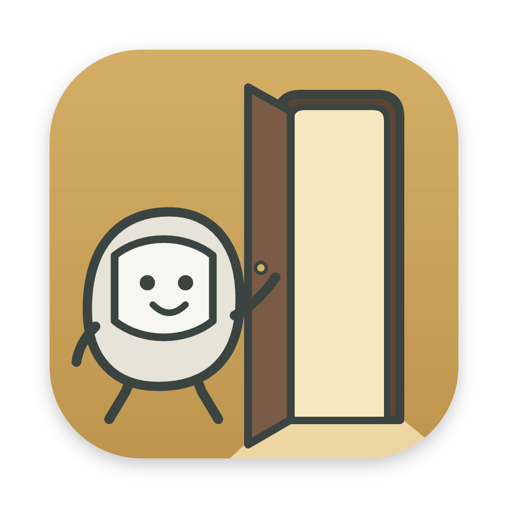
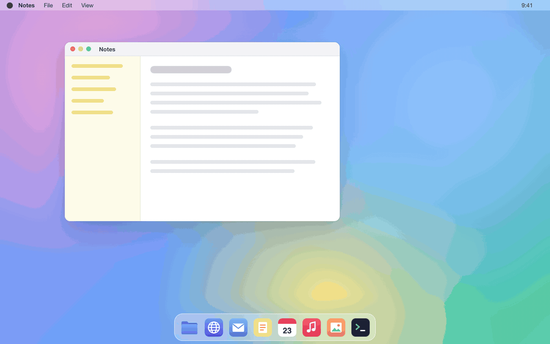

# OpenSesame!

English | [日本語](README.ja.md)



OpenSesame! is a launcher for macOS that appears only while you hold down a key.

Hold the activation keys (Left Control + Left Option by default) and a keyboard-shaped panel appears. Press one of your assigned keys to open an app, a folder or a website, run a command, snap the frontmost window to the left half, right half and more, or change the display resolution or the wallpaper.

OpenSesame! is part of [kobito-tools](https://github.com/kobito-tools), a series of small Mac apps.



## What it can do

| Type | What happens when you press the key |
|---|---|
| Window layout | Moves and resizes the frontmost window: halves, quarters, thirds, two thirds, edge adjustments, moving to the next display and more. See [Window layouts](#window-layouts) |
| App | Launches the app, or brings it to the front. It can also hide the app if it is already in front |
| Folder | Opens the folder in Finder |
| Website | Opens the URL in your default browser |
| Command | Runs a one-line terminal command, such as `uv run app.py` |
| Resolution | Changes a display to the resolution you chose, or switches between two or more on each press. See [Change the display resolution](#change-the-display-resolution) |
| Wallpaper | Sets a chosen image as the wallpaper of all displays or of one display. See [Change the wallpaper](#change-the-wallpaper) |

Each key can hold two items: one on the main layer and one on the Shift layer.

## Requirements

- macOS 11 or later (Apple Silicon or Intel)
- Installing builds the app on your Mac, so the first install takes several minutes.

## Install

OpenSesame! is installed by getting its source code and running `setup.sh` in Terminal. The script checks the tools it needs, builds `OpenSesame!.app` on your Mac and puts it in the Applications folder. An app you build yourself does not show the “unidentified developer” warning on first launch.

### 1. Get the source code

Use either way. Put the folder somewhere you will keep it, such as your home folder. You will use it again to update.

| Way | How |
|---|---|
| Git | In Terminal, run `git clone https://github.com/kobito-tools/OpenSesame.git`. This makes an `OpenSesame` folder |
| ZIP | On this page on GitHub, click **Code → Download ZIP**, then double-click the ZIP to unzip it. This makes an `OpenSesame-main` folder |

### 2. Run setup.sh

In Terminal, go to that folder and run `setup.sh`:

```bash
cd OpenSesame
./setup.sh
```

For the ZIP, use `cd OpenSesame-main` (or type `cd `, drag the folder onto the Terminal window and press Return).

It asks a few questions as it goes. Press Return to choose the answer shown in capitals.

| Option | What it does |
|---|---|
| `./setup.sh --help` | Shows the options and the steps |
| `./setup.sh --dry-run` | Shows what it would do, without changing anything |
| `./setup.sh --yes` | Uses the default answer for every question (the app is then not moved to Applications) |

It is safe to run more than once.

### 3. What setup.sh does

| Step | What happens |
|---|---|
| Check tools | Checks for the Xcode Command Line Tools and Node.js 20 or later. If one is missing, it shows how to install it (`xcode-select --install`, or Node.js from [nodejs.org](https://nodejs.org/) or `brew install node`) and stops. Install it and run `./setup.sh` again |
| Rust | If Rust is missing, it asks whether to install it with the official installer ([rustup](https://rustup.rs/)) |
| Build | Builds `OpenSesame!.app` in the source folder. This takes a few minutes |
| Move to Applications | Asks whether to move the app to the `kobito-tools` folder in Applications (`/Applications/kobito-tools/`). Answer **y**. If the folder does not exist, it is created with the series icon. If OpenSesame! is already there, it asks before replacing it |
| Launch info | Writes a small file that tells other apps in the series how to launch OpenSesame! (see [Working with other apps](#working-with-other-apps)) |
| Remember the folder | Records where the source folder is, as a link at `~/Library/Application Support/kobito-tools/repos/opensesame` |
| Permissions | Shows how to allow Accessibility, and the command to start the app |

If you answer **n** to moving the app, `OpenSesame!.app` stays in the source folder. It still works, but macOS keeps the permissions more reliably when the app is in the Applications folder. You can move it yourself later.

An older `OpenSesame!.app` directly in `/Applications` is left alone. If you no longer use it, move it to the Trash.

### 4. Start OpenSesame!

Open the `kobito-tools` folder in Applications and double-click OpenSesame!. You can also run the `open` command shown at the end of `setup.sh`.

> **Note:** Start it from the Applications folder. If you start it from somewhere else, macOS may not keep the permissions below.

### Allow Accessibility

OpenSesame! needs Accessibility permission to notice your key presses while you are using other apps. On first launch, the settings window shows a guide.

1. Click **Open Accessibility settings** in the guide.
2. Click **+** below the list and add OpenSesame! from the `kobito-tools` folder in Applications.
3. Turn on the switch next to OpenSesame!.

Within a few seconds the guide disappears and OpenSesame! starts listening. You do not need to restart it.

### Allow Automation

The first time you use a window layout, macOS asks whether “OpenSesame!” may control “System Events”. Click **Allow**.

### Switch the settings window to English

The settings window starts in Japanese. Use the language menu at the top right to choose **English**. The menu bar items follow the language the next time OpenSesame! starts.

## Update

Your settings and registered items are kept when you update.

1. Quit OpenSesame! (menu bar icon → **Quit OpenSesame!**). `setup.sh` does not replace an app that is running.
2. Get the new source code.
   - Git: in the source folder, run `git pull`.
   - ZIP: move the old `OpenSesame-main` folder to the Trash, then download and unzip the ZIP again.
3. Run `./setup.sh` again and answer **y** to moving and replacing the app.
4. In **System Settings → Privacy & Security → Accessibility**, select OpenSesame!, remove it with **−**, and add it again. Each build has a new signature, so the old permission no longer applies.

## How to use

### Basic keys

| Keys | What happens |
|---|---|
| Hold the activation keys | Shows the panel |
| Activation keys + an assigned key | Runs that item: opens an app, folder or website, runs a command, lays out the window, or changes the resolution or wallpaper |
| Activation keys + Shift | Switches to the Shift layer. Release Shift to go back |
| Activation keys + Shift + an assigned key | Runs the item on the Shift layer |
| Activation keys + `.` (period) | Opens the settings window |
| Release the activation keys | Hides the panel |

Closing the settings window does not quit OpenSesame!. It keeps running in the background.

### Assign a key

1. In the keyboard at the top of the settings window, click a free key.
2. Choose **Window layout**, **Launch an app**, **Open a folder**, **Open a website**, **Run a command**, **Change the resolution** or **Change the wallpaper**.
3. For an app or a folder, pick it in the dialog. For a website, enter the URL (`https://` can be left out) and a display name. For a command, see [Run a command](#run-a-command).

You can also use **＋ App**, **＋ Folder**, **＋ Website**, **＋ Command**, **＋ Resolution** and **＋ Wallpaper** at the top right. They assign a free key for you.

In the list at the bottom of the settings window, you can change an item’s display name and key. Drag an assigned key onto another key on the keyboard to move it. Click **Icon** to use any PNG image as the icon.

For apps, turn on **Hide if in front** to hide the app when you press its key while it is already in front. Each press then switches between showing and hiding it.

### Window layouts

Window layouts work on the frontmost window, within the display it is mostly on. The menu bar and the Dock are left uncovered.

| Group | Layouts |
|---|---|
| Halves | Left, right, top and bottom half |
| Quarters | Top left, top right, bottom left and bottom right quarter |
| Thirds | Left, center and right third; top, middle and bottom third |
| Two thirds | Left, center and right two thirds; top, middle and bottom two thirds |
| Edges | Grow or shrink the left, right, top or bottom edge. Each press moves only that edge by 1/12 of the screen, so press repeatedly to fine-tune. It stops at the screen edge and at a minimum size |
| Move & more | Center (keeps the size), almost maximize (leaves a small margin), maximize, move to next display, restore |

- **Move to next display** moves the window to the next display from left to right (after the last one, back to the first), keeping its relative position and size.
- **Restore** puts the window back where it was before OpenSesame! first arranged it. Several layouts in a row still restore to the starting point. If you have moved the window by hand since, there is nothing to restore.

When you choose **Window layout** for a key, the layouts are shown in these groups with a small diagram each. Type in the search box to search all groups. In the list at the bottom of the settings window, **Layouts without a key** shows the same groups, and you can pick a key for each layout there.

### Run a command

You can assign the same command you would type in Terminal, for example `uv run app.py` to start a Python app.

| Field | What to enter |
|---|---|
| Command (one line) | The command, as you would type it in Terminal. No line breaks. Join several commands with `&&` to run them in order |
| Working folder (optional) | The folder to run the command in. Use **Choose…** to pick one. Empty means your home folder |
| Display name | The name shown on the panel and in the list. Empty means the first word of the command |

- The command runs through a login shell (`/bin/zsh -l`). The `PATH` you set in `~/.zprofile` is loaded, so commands such as `uv` that work in Terminal are found. If you set `PATH` only in `~/.zshrc`, the command may not be found. Add it to `~/.zprofile` too, or write the full path (for example `~/.local/bin/uv run app.py`).
- OpenSesame! starts the command and does not wait for it to finish. If the command cannot start, or exits with an error right away (within 3 seconds), the settings window opens and shows the exit code and the last line of the error at the bottom.
- The command’s output is not shown.
- Use **Edit** in the list to change a command. Use **Icon** to pick a PNG image (▶️ is shown otherwise).

> **Warning:** A registered command runs as is every time you press its key. Register only commands you understand.

### Change the display resolution

Choose **Change the resolution** for a key, then pick a display from the tabs at the top and a resolution from the tiles.

- The tiles show each resolution as it looks (for a Retina or other HiDPI display, the “looks like” size), one per size, with modes that match the display’s shape. **Current** marks the resolution in use and **Default** the display’s default. Turn on **More** to also see each refresh rate, non-HiDPI modes and modes with a different aspect ratio.
- Pick two or more tiles to switch between them in the order you picked (up to 8). Each press moves to the next one, and back to the first after the last. Use this to switch between, say, a larger-text and a more-space resolution with one key.
- The display is remembered by its maker, model, serial number and name, so the key still works after you unplug and reconnect it, even on another port.
- If the display is not connected, or it does not offer that resolution, nothing changes and the settings window opens to tell you.
- The change stays after you log out, just like changing it in System Settings. Use **Edit** in the list to pick other resolutions.

### Change the wallpaper

Choose **Change the wallpaper** for a key.

| Field | What to enter |
|---|---|
| Image file | The path of the image. Type it, or use **Choose…** to pick one. PNG, JPEG, HEIC and other image files work |
| Display | **All displays**, or one display |
| Fit | **Fill screen**, **Fit to screen**, **Stretch** or **Center** |
| Display name | The name shown on the panel and in the list. Empty means the image file name |

- macOS changes the wallpaper only for the Space currently shown on each display. To change it on other Spaces (desktops), switch to them and press the key again.
- If the image has been moved or deleted, or the chosen display is not connected, nothing changes and the settings window opens to tell you.
- Use **Edit** in the list to change the image, display or fit.

### Use the Shift layer

Switch the keyboard at the top right to **Shift layer** to assign a second set of items. The same key can hold one item on the main layer and another on the Shift layer. To run a Shift-layer item, hold Shift as well as the activation keys.

If Shift is one of your activation keys, that Shift does not switch layers. For example, if Left Shift is an activation key, use Right Shift for the Shift layer.

### Change the activation keys

1. Hover over the **Activation keys** field in the settings window and press delete.
2. Press the modifier keys you want together, then release them.

You can combine up to three of Control, Option, Command and Shift. Left and right keys are told apart. Shift alone cannot be used. To cancel, press Esc before step 2.

### Change the language and keyboard layout

At the top right of the settings window, switch the language (日本語 / English) and the keyboard layout (JIS / ANSI).

### Open at login

At the top right of the settings window, set **Open at login** to **On**. OpenSesame! then starts in the menu bar when you log in, without opening the settings window. Set it to **Off** to stop. If you added OpenSesame! to **System Settings → General → Login Items** yourself before, remove it there so it is not started twice.

### Quit

Click the OpenSesame! icon in the menu bar and choose **Quit OpenSesame!**.

## Troubleshooting

### The panel does not appear

- Make sure Accessibility permission is turned on. If it stopped working after an update, select OpenSesame! in the Accessibility list, remove it with **−**, and add it again.
- If you use VoiceOver, the default activation keys (Control + Option) are the same as the VoiceOver modifier. Change the activation keys.
- While you type in a password field, or while Terminal’s **Secure Keyboard Entry** is on, macOS does not pass key presses to other apps. The panel may not appear, or its keys may do nothing. Move to another field or turn Secure Keyboard Entry off.
- Some full-screen games take over the whole display, and nothing can be shown on top of them. Switch the game to windowed or borderless mode.

### Windows are not laid out

Open **System Settings → Privacy & Security → Automation** and make sure “System Events” is turned on under OpenSesame!.

### setup.sh stops with “A repository with the same app ID exists in another location”

Another copy of the OpenSesame! source folder is already recorded on this Mac, for example from an earlier clone or ZIP. `setup.sh` stops without changing anything rather than picking one. Decide which folder to keep:

- To keep the recorded one, stop using the new folder and move it to the Trash.
- To use the new one, move the old folder to the Trash (or run the `rm` command `setup.sh` shows to remove only the record), then run `./setup.sh` again.

### “Target not found” appears and settings cannot be saved

A registered app or folder was moved or deleted, or it is on an external drive that is not connected. Remove the item from the list, or connect the drive.

### The resolution or wallpaper does not change

The bottom of the settings window tells you why. “Not connected” means the display you chose is not connected now. “No display mode matches” means the display does not offer that resolution now, for example after you connected it through a different adapter. Use **Edit** to pick the resolution again. For the wallpaper, “Image not found” means the image was moved or deleted.

### Nothing happens when I press a command’s key

If the bottom of the settings window says the command stopped right away with exit code 127, the command was not found. Check your `PATH` or use the full path, as described in [Run a command](#run-a-command). The last line of the command’s error follows the exit code.

### “Some items are turned off” appears

The config file (`config.json`) holds entries that the settings window would not save. For example, a website URL that does not start with `http://` or `https://`, or an app or folder location written as a URL. Something other than OpenSesame! may have changed the config file.

The items listed there do nothing when you press their keys. If you do not recognize an item, remove it from the list. If you do, remove it and register it again (a command can be fixed with **Edit**). You can remove or fix them one at a time and save.

### My settings went back to the defaults

If the config file was damaged, OpenSesame! keeps the original as `config.json.broken-<number>` and starts with the default settings. You can find that file in the settings folder listed in [Uninstall](#uninstall).

## Uninstall

1. If **Open at login** is **On**, set it to **Off** in the settings window.
2. Quit OpenSesame!.
3. Move OpenSesame! from the `kobito-tools` folder in Applications to the Trash. If you did not move it there during setup, it is in the source folder. Leave the `kobito-tools` folder itself if it holds other apps.
4. In **System Settings → Privacy & Security → Accessibility**, select OpenSesame! and remove it with **−**.
5. If you no longer need the source folder, move it to the Trash as well.

To remove your settings as well, delete this folder:

- `~/Library/Application Support/io.github.kobito-tools.opensesame`

To also remove what `setup.sh` recorded, delete these:

| What | Where |
|---|---|
| Launch info file (see [Working with other apps](#working-with-other-apps)) | `~/Library/Application Support/kobito-tools/apps/opensesame.json` |
| Link to the source folder | `~/Library/Application Support/kobito-tools/repos/opensesame` |

## Privacy

OpenSesame! does not use the network. Key presses are used only to detect the activation keys and the assigned keys. They are never recorded or sent anywhere. Your settings are stored only on your Mac.

## For developers

### Build from source

`setup.sh` builds the app with `build.sh`, which runs `npm ci` and `tauri build --bundles app` and puts `OpenSesame!.app` in the repository folder. Both scripts are for macOS. The steps `setup.sh` shares with the rest of the series are in `docs/kobito-spec/setup.zsh`.

For running in development mode (`npm run tauri dev`), tests, the source layout, and how to try `setup.sh` without touching your real Applications folder (`KOBITO_APPLICATIONS_DIR`, `KOBITO_CONFIG_DIR`), see [docs/DEVELOPMENT.md](docs/DEVELOPMENT.md) (in Japanese).

### Working with other apps

OpenSesame! connects to other apps only through the data formats defined in `docs/kobito-spec/CONTRACTS.md`.

Each time it starts, OpenSesame! writes how to launch it and how to show it (name, color and icon) as “launch info” on your Mac. Other apps in the series read this file to show OpenSesame! as a launch button. OpenSesame! is a utility, so it does not show up inside other apps.

- Location: `~/Library/Application Support/kobito-tools/apps/opensesame.json`
- To write the file without opening a window, run `OpenSesame!.app/Contents/MacOS/OpenSesame --write-launch-info`. It writes the file and exits.
- Only how to launch and show the app is written. Your settings and registered items are not.
- To print the same content to standard output without writing the file, use `--metadata`.
- `kobito-app.json` at the repository root marks this as a kobito-tools app. The icons (`icon.svg`, `icon-1024.png`) are in `kobito/`. It is shipped as an app, so its kind is `"native"` (see `docs/kobito-spec/APP_PACKAGE.md`).

### Issues

Bug reports and requests are welcome in [Issues](../../issues).

### How this was made

OpenSesame! was developed with the help of ChatGPT (OpenAI) and Claude (Anthropic). This is a personal project and is not affiliated with OpenAI or Anthropic.

### License

OpenSesame! is released under the [MIT License](LICENSE).

The software is provided “as is”, without warranty of any kind. The author is not liable for any damage arising from its use. See [LICENSE](LICENSE) for details.
