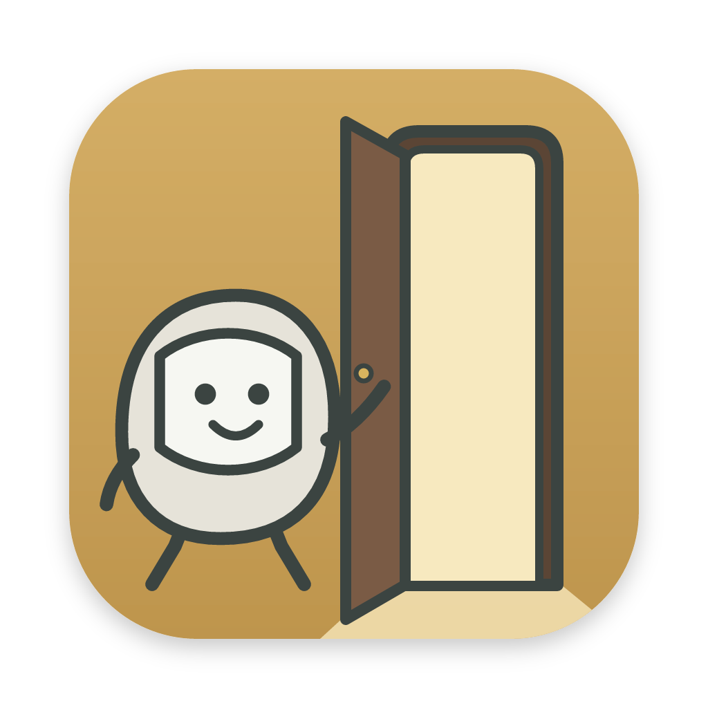
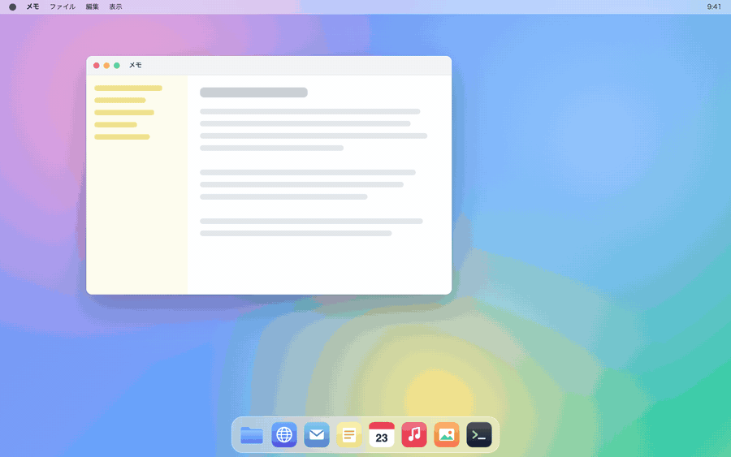

# OpenSesame!



OpenSesame! は、キーを押している間だけ表示される macOS / Windows 用のランチャーです。

起動キー（初期設定では macOS は左 Control + 左 Option、Windows は左 Ctrl + 左 Alt）を押している間、キーボード型のパネルが表示されます。そのまま割り当てたキーを押すと、アプリケーションやフォルダ、Webサイトを開いたり、コマンドを実行したり、前面のウィンドウを画面の左半分・右半分などに配置したりできます。

kobito シリーズの1つです。ほかのアプリとは、約束（`docs/kobito-spec/CONTRACTS.md`）のデータの形だけでつながります。シリーズについては [kobito-tools](https://github.com/kobito-tools) を参照してください。



## 動作環境

- macOS 11 以降（Apple Silicon / Intel）
- Windows 10 / 11（64 ビット）

## ダウンロード

[Releases](../../releases/latest) ページから、お使いの OS に対応したファイルをダウンロードしてください。

| OS | ファイル |
|---|---|
| macOS | `OpenSesame!_x.y.z_universal.dmg` |
| Windows | `OpenSesame!_x.y.z_x64-setup.exe` |

`x.y.z` にはバージョン番号が入ります。

## インストール

### macOS

1. ダウンロードした `.dmg` ファイルを開きます。
2. OpenSesame! を Applications フォルダにドラッグします。
3. アプリケーションフォルダから OpenSesame! を起動します。

本アプリは Apple の公証を受けていないため、初回起動時に「開発元を確認できません」などの警告が表示されます。その場合は警告を閉じ、「システム設定」→「プライバシーとセキュリティ」を開いて、画面下部の「このまま開く」をクリックしてください。2 回目以降は通常どおり起動できます。

「壊れているため開けません」と表示される場合は、ターミナルで次のコマンドを実行してから、再度起動してください。

```bash
xattr -dr com.apple.quarantine "/Applications/OpenSesame!.app"
```

> **注意:** アプリケーションフォルダ以外の場所（ダウンロードフォルダなど）から起動すると、次の手順で設定する許可が保持されない場合があります。

#### ソースから作る

警告を出さずに入れたい場合は、このリポジトリをクローンして、ターミナルで `./setup.sh` を実行します（Finder から `Setup.command` をダブルクリックしても同じです）。手元で作ったアプリには、ダウンロードしたときに付く隔離の印が無いため、上の警告は出ません。

- 必要なもの：Xcode Command Line Tools・Node.js 20 以降・Rust
  - Rust が無いときは、公式の手順（rustup）で入れるかを尋ねます。
  - Xcode Command Line Tools と Node.js が無いときは、入れ方を表示して止まります。
- ビルドが終わると、`OpenSesame!.app` をアプリケーションフォルダの `kobito-tools` フォルダ（`/Applications/kobito-tools/`）へ移すかを尋ねます。フォルダが無ければ作り、シリーズのアイコンを付けます。すでに `OpenSesame!.app` がある場合は、置き換えてよいかを尋ねます。移さなかったときは、このフォルダにできた `OpenSesame!.app` を自分で移して起動します。
- `/Applications` の直下に以前の `OpenSesame!.app` が残っていても、消しません。使わなければ、自分でゴミ箱へ移してください。
- 最後に、置いた場所の `OpenSesame!.app` で起動情報を書き出します（下の「kobito シリーズとのつながり」）。画面は開かず、動いている OpenSesame! も止めません。あわせて、このリポジトリの場所を PC 固有領域の `kobito-tools/repos/opensesame` にシンボリックリンクで記します。
- `./setup.sh --help` で使い方を、`./setup.sh --dry-run` で何をするかを（何も変えずに）確かめられます。何度実行しても大丈夫です。
- 作り直した場合は、アクセシビリティの一覧から OpenSesame! を「－」で消して、追加し直してください（作るたびに署名が変わるため、以前の許可が効かなくなります）。

#### アクセシビリティの許可

OpenSesame! は、他のアプリケーションを操作している間もキー入力を検知するため、macOS のアクセシビリティの許可を必要とします。初回起動時に設定画面に案内が表示されるので、次の手順で許可してください。

1. 案内の「アクセシビリティ設定を開く」をクリックします。
2. 一覧の下にある「＋」をクリックし、アプリケーションフォルダから OpenSesame! を追加します。
3. OpenSesame! のスイッチをオンにします。

許可が有効になると、数秒で案内が消えてキー入力の監視が始まります。アプリの再起動は不要です。

#### オートメーションの許可

ウィンドウ配置の機能を初めて使用すると、「“OpenSesame!”が“System Events”を制御しようとしています」という確認が表示されます。「許可」をクリックしてください。

### Windows

1. ダウンロードした `-setup.exe` ファイルを実行します。
2. 「Windows によって PC が保護されました」と表示された場合は、「詳細情報」をクリックしてから「実行」をクリックします。この画面は、本アプリがコード署名されていないために表示されます。
3. インストーラーの指示に従ってインストールします。

Windows では、追加の許可設定は必要ありません。

## 使い方

### 基本操作

| 操作 | 動作 |
|---|---|
| 起動キーを押し続ける | パネルを表示します |
| 起動キー + 割り当てたキー | アプリケーション・フォルダ・Webサイトを開く、コマンドを実行する、またはウィンドウを配置します |
| 起動キー + Shift | 裏盤面に切り替えます。Shift を離すと表盤面に戻ります |
| 起動キー + Shift + 割り当てたキー | 裏盤面に割り当てた項目を実行します |
| 起動キー + `.`（ピリオド） | 設定画面を開きます |
| 起動キーを離す | パネルを閉じます |

設定画面を閉じても、OpenSesame! はバックグラウンドで動作し続けます。

### 項目を登録する

1. 設定画面上部のキーボード図で、割り当てていないキーをクリックします。
2. 「ウィンドウサイズ変更」「アプリの起動」「フォルダの選択」「Webサイトを開く」「コマンドを実行」のいずれかを選択します。
3. アプリケーションまたはフォルダを選択した場合は、表示されたダイアログで対象を指定します。Webサイトを選択した場合は、URL（`https://` は省略可）と表示名を入力します。Webサイトは既定のブラウザで開きます。コマンドを選択した場合は、下の「コマンドを登録する」を見てください。

設定画面右上の「＋ アプリ」「＋ フォルダ」「＋ Webサイト」「＋ コマンド」から登録することもできます。この場合、空いているキーが自動的に割り当てられます。

登録した項目は、設定画面下部の一覧で表示名や割り当てキーを変更できます。「アイコン」をクリックすると、任意の PNG 画像をアイコンとして設定できます。

アプリの「前面なら隠す」をオンにすると、そのアプリが前面にあるときにもう一度キーを押すとアプリを隠します（Windows では最小化します）。押すたびに表示と非表示を切り替えられます。

### コマンドを登録する

ターミナルで打つコマンドを、そのままキーに割り当てられます。たとえば Python で作ったアプリを `uv run app.py` で起動する、といった使い方ができます。

| 欄 | 入れるもの |
|---|---|
| コマンド（1行） | ターミナルで打つのと同じコマンド。改行は入れられません。`&&` でつなげば、いくつかのコマンドを順に動かせます |
| 作業フォルダ（任意） | コマンドを動かすフォルダ。「選ぶ…」で選べます。空のときはホームフォルダで動きます |
| 表示名 | パネルと一覧に出る名前。空のときはコマンドの最初の語になります |

- **macOS** では、ログインシェル（`/bin/zsh -l`）を通して動かします。`~/.zprofile` で通した PATH が読まれるので、ターミナルで使える `uv` などのコマンドがそのまま見つかります。`~/.zshrc` だけで PATH を通している場合は見つからないことがあるので、`~/.zprofile` にも書くか、コマンドをフルパス（例: `~/.local/bin/uv run app.py`）で書いてください。
- **Windows** では、`cmd /C` で動かします。コマンドプロンプトの窓は出ません。
- コマンドは終わるのを待たずに動かします。起動できなかったときや、動かしてすぐ（3秒以内）にエラーで終わったときは、設定画面が開いて、下の知らせ欄に終了コードとエラーの最後の行が出ます。
- コマンドの出力（画面に出る文字）は表示しません。
- 登録したコマンドは、一覧の「編集」で書き換えられます。アイコンは「アイコン」から PNG 画像を選べます（選ばないときは ▶️ を出します）。

> **注意:** 登録したコマンドは、キーを押すたびにそのまま実行されます。中身の分かっているコマンドだけを登録してください。

### 裏盤面（Shift）を使う

キーボード図の右上で「裏盤面（Shift）」に切り替えると、表盤面とは別の割り当てを登録できます。同じキーでも、表盤面と裏盤面で別々の項目を割り当てられます。裏盤面の項目は、起動キーに加えて Shift を押しながらキーを押すと実行されます。

起動キーに Shift を含めている場合、そちらの Shift は裏盤面の切り替えに使われません（左 Shift を起動キーにしている場合は、右 Shift で切り替えます）。

### 起動キーを変更する

1. 設定画面の「起動キー」欄にマウスポインタを合わせ、delete キー（Windows では Backspace キー）を押します。
2. 使用したい修飾キーを同時に押し、離します。

Control、Option（Alt）、Command（Windows キー）、Shift のうち最大 3 つまで組み合わせることができ、左右のキーは区別されます。変更を取り消すには、手順 2 の前に Esc キーを押します。

### 表示を切り替える

設定画面右上で、表示言語（日本語 / English）とキーボード配列（JIS 配列 / 英字配列）を切り替えられます。

### ログイン時に自動で起動する

- **macOS:** 「システム設定」→「一般」→「ログイン項目」を開き、「ログイン時に開く」の「＋」から OpenSesame! を追加します。
- **Windows:** `Windows キー + R` を押して `shell:startup` を実行し、開いたフォルダに OpenSesame! のショートカットを配置します。

### 終了する

メニューバー（Windows ではタスクバーの通知領域）の OpenSesame! アイコンをクリックし、「OpenSesame! を終了」を選択します。

## トラブルシューティング

### 起動キーを押してもパネルが表示されない（macOS）

- アクセシビリティの許可が有効になっているか確認してください。アプリを更新した後に動作しなくなった場合は、一覧から OpenSesame! を「－」で削除し、再度追加してください。
- VoiceOver を使用している場合、初期設定の起動キー（Control + Option）が VoiceOver の操作キーと重複します。起動キーを変更してください。

### 起動キーを押してもパネルが表示されない（Windows）

管理者権限で実行されているアプリケーションが前面にある場合、Windows の仕様によりキー入力を検知できません。

### ウィンドウが配置されない（macOS）

「システム設定」→「プライバシーとセキュリティ」→「オートメーション」で、OpenSesame! の「System Events」がオンになっているか確認してください。

### 「対象が見つかりません」と表示され、設定を保存できない

登録したアプリケーションやフォルダが移動・削除されているか、外付けドライブが接続されていません。一覧から該当する項目を削除するか、ドライブを接続してください。

### コマンドを登録したキーを押しても何も起きない

設定画面の知らせ欄に「コマンドがすぐに終わりました（終了コード 127 …）」と出た場合は、コマンドが見つかっていません。上の「コマンドを登録する」にあるとおり、PATH の設定か、コマンドのフルパスを確かめてください。終了コードの後ろには、コマンドが出したエラーの最後の行が付きます。

### 設定が初期状態に戻った

設定ファイルが破損していた場合、OpenSesame! は元のファイルを `config.json.broken-<数字>` という名前で保存し、初期設定で起動します。このファイルは下記の設定フォルダにあります。

## アンインストール

### macOS

1. OpenSesame! を終了します。
2. アプリケーションフォルダの OpenSesame! をゴミ箱に移動します（`setup.sh` で入れた場合は `kobito-tools` フォルダの中にあります）。
3. 「システム設定」→「プライバシーとセキュリティ」→「アクセシビリティ」の一覧から OpenSesame! を選択し、「－」で削除します。

### Windows

1. OpenSesame! を終了します。
2. 「設定」→「アプリ」→「インストールされているアプリ」から OpenSesame! をアンインストールします。

### 設定の削除

設定も削除する場合は、次のフォルダを削除してください。

- **macOS:** `~/Library/Application Support/io.github.kobito-tools.opensesame`
- **Windows:** `%LOCALAPPDATA%\io.github.kobito-tools.opensesame`

起動情報（下の「kobito シリーズとのつながり」）も消す場合は、次のファイルを削除してください。

- **macOS:** `~/Library/Application Support/kobito-tools/apps/opensesame.json`
- **Windows:** `%APPDATA%\kobito-tools\apps\opensesame.json`

## kobito シリーズとのつながり

OpenSesame! は、起動するたびに、自分の起動のしかたと見せ方（名前・色・アイコン）を「起動情報」として PC の中に書き出します。シリーズのほかのアプリは、これを読んで OpenSesame! を起動ボタンとして並べます。OpenSesame! はユーティリティなので、ほかのアプリの中には表示しません。

- 置き場所：macOS は `~/Library/Application Support/kobito-tools/apps/opensesame.json`、Windows は `%APPDATA%\kobito-tools\apps\opensesame.json`
- 画面を開かずに書き出すだけのときは、`OpenSesame!.app/Contents/MacOS/OpenSesame --write-launch-info` を実行します。書き出してすぐ終わります。
- 書き出すのは起動のしかたと見せ方だけで、設定や登録した項目は書きません。
- 書き出さずに、同じ内容を画面（標準出力）に出すだけのときは `--metadata` を付けます。
- リポジトリの直下の `kobito-app.json` は、kobito シリーズのアプリであることを示す目印で、`kobito/` にアイコン（`icon.svg`・`icon-1024.png`）を置いています（アプリの形で配るので `"kind": "native"`。決まりは `docs/kobito-spec/APP_PACKAGE.md`）。

## プライバシー

OpenSesame! はネットワーク通信を行いません。キー入力は、起動キーと割り当てキーの判定にのみ使用し、記録や外部への送信は行いません。設定はお使いのコンピューター内にのみ保存されます。

## ライセンス

本ソフトウェアは [MIT License](LICENSE) のもとで提供されています。

本ソフトウェアは現状のまま提供され、いかなる保証もありません。本ソフトウェアの使用によって生じたいかなる損害についても、作者は責任を負いません。詳細は [LICENSE](LICENSE) を参照してください。

## 開発について

本ソフトウェアの開発には、ChatGPT（OpenAI）および Claude（Anthropic）を使用しています。本プロジェクトは個人によるものであり、OpenAI および Anthropic とは関係ありません。

ビルド方法やソースコードの構成については、[docs/DEVELOPMENT.md](docs/DEVELOPMENT.md) を参照してください。不具合の報告や要望は [Issues](../../issues) で受け付けています。
